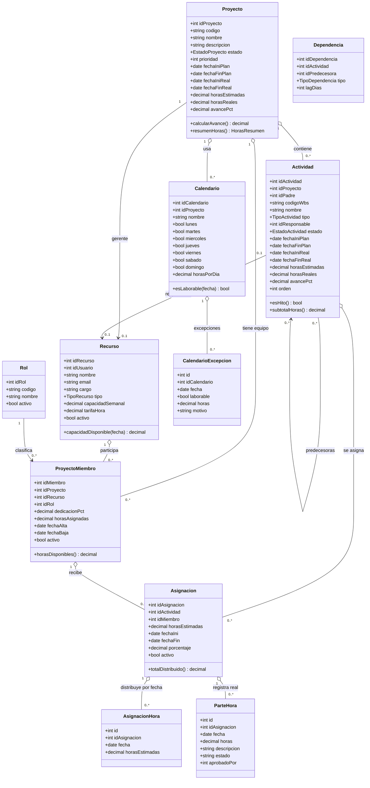
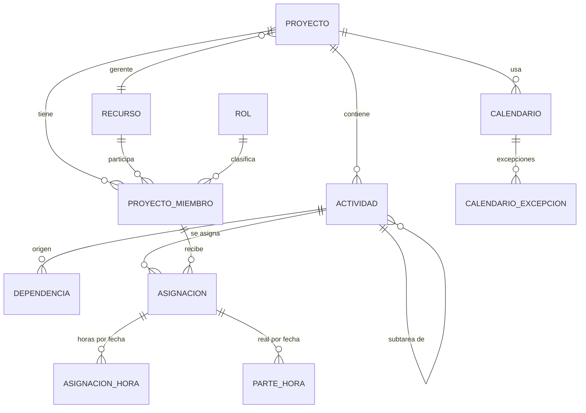

# Módulo GPI - Gestión de Proyectos Internos

Propuesta conceptual, modelo físico de datos y diagrama de clases. **Estado: IMPLEMENTADO e integrado al sistema** (esquema `gpi`, módulo NestJS + Angular y sistema **GPI** en Seguridad).

Sistema **SIGESP** · Backend NestJS · Frontend Angular · PostgreSQL.
Esquema propuesto: **`gpi`** (Gestión de Proyectos Internos).

> **Aclaratoria:** este módulo es **independiente** del módulo **SGH**. SGH registra
> actividades y horas **a clientes**; GPI planifica **proyectos internos** (equipo,
> actividades, fechas y horas estimadas/reales). No reutiliza las tablas de SGH.

---

## 1. Objetivo

Planificar y controlar **proyectos internos** al estilo MS Project:

- Definir el **equipo** del proyecto (consultores, desarrolladores, líderes, QA...).
- Definir las **actividades** (tareas/WBS) con **fechas** planificadas y reales.
- Asignar **horas estimadas** a cada actividad **por recurso y por fecha**
  (distribución diaria / *timephased*), y luego registrar las **horas reales**.
- Ver avance, dependencias (Gantt) y capacidad del equipo.

---

## 2. Alcance

**Incluye**
- Proyectos, equipo (miembros) y roles.
- Actividades jerárquicas (WBS), hitos y dependencias.
- Asignación de recursos a actividades y **distribución de horas por fecha**.
- Parte de horas real (timesheet) con aprobación.
- Calendario laborable (para el cálculo de fechas/capacidad).

**No incluye (fase posterior)**
- Costos/facturación al cliente (es interno; solo tarifa informativa).
- Nivelación automática de recursos (algoritmo MS Project).
- Ruta crítica automática (se puede calcular en fase 2).

---

## 3. Conceptos y entidades

| Entidad | Descripción |
|---|---|
| **Proyecto** | Proyecto interno: código, nombre, gerente, área solicitante, fechas, horas, avance. |
| **Recurso** | Persona (consultor/desarrollador/analista...). Puede enlazarse a un usuario del sistema. |
| **Rol** | Catálogo de roles en el proyecto (Líder, Consultor, Desarrollador, QA...). |
| **MiembroProyecto** | Recurso asignado al proyecto, con rol, dedicación y horas. |
| **Actividad** | Tarea del proyecto (WBS). Jerárquica, con fechas plan/real, horas y avance. |
| **Dependencia** | Relación entre actividades (FS/SS/FF/SF) con retardo (*lag*). |
| **Asignación** | Recurso (miembro) asignado a una actividad con horas estimadas. |
| **AsignaciónHora** | **Horas estimadas por fecha** de una asignación (distribución diaria). |
| **ParteHora** | **Horas reales por fecha** (timesheet) con estado de aprobación. |
| **Calendario / Excepción** | Días laborables y feriados (para fechas y capacidad). |

---

## 4. Reglas de negocio

1. Un **proyecto** tiene 1 **gerente** (recurso) y N **miembros**.
2. Un **recurso** no se repite en el mismo proyecto (`UNIQUE proyecto+recurso`).
3. Una **actividad** pertenece a un proyecto y puede tener una **actividad padre**
   (WBS). `tipo = 'hito'` representa un hito (sin duración).
4. Las **fechas plan** deben cumplir `fecha_ini_plan <= fecha_fin_plan`.
5. **Horas estimadas de la actividad** = suma de las horas estimadas de sus
   **asignaciones**; a su vez, cada asignación se distribuye por fecha en
   `asignacion_horas` (Σ horas por fecha = horas estimadas de la asignación).
6. **Horas reales** provienen de `parte_horas` (Σ por asignación).
7. **Avance** de la actividad: manual (`avance_pct`) o calculado por horas
   (`horas_reales / horas_estimadas`). El del proyecto es el ponderado por horas.
8. **Capacidad**: la suma de horas/día de un recurso no debería superar su
   capacidad del calendario (alerta de sobre-asignación).
9. Al eliminar un proyecto/actividad se eliminan en cascada sus dependientes.

---

## 5. Modelo físico de datos (PostgreSQL)

```sql
CREATE SCHEMA IF NOT EXISTS gpi;

-- ===== Enumeraciones =====
CREATE TYPE gpi.estado_proyecto  AS ENUM ('planificado','en_ejecucion','en_pausa','cerrado','cancelado');
CREATE TYPE gpi.estado_actividad AS ENUM ('pendiente','en_proceso','bloqueada','completada','cancelada');
CREATE TYPE gpi.tipo_actividad   AS ENUM ('tarea','resumen','hito');
CREATE TYPE gpi.tipo_dependencia AS ENUM ('FS','SS','FF','SF');
CREATE TYPE gpi.tipo_recurso     AS ENUM ('consultor','desarrollador','analista','lider','qa','soporte','otro');

-- ===== Recursos y roles =====
CREATE TABLE gpi.recurso (
  id_recurso        SERIAL PRIMARY KEY,
  id_usuario        INTEGER,                 -- enlace opcional a usuario del sistema
  nombre            VARCHAR(150) NOT NULL,
  email             VARCHAR(150),
  cargo             VARCHAR(100),
  tipo              gpi.tipo_recurso NOT NULL DEFAULT 'consultor',
  area              VARCHAR(100),
  capacidad_semanal NUMERIC(5,2)  NOT NULL DEFAULT 40,   -- horas/semana
  tarifa_hora       NUMERIC(12,2),                        -- informativa
  activo            BOOLEAN NOT NULL DEFAULT TRUE,
  created_at        TIMESTAMPTZ NOT NULL DEFAULT NOW(),
  updated_at        TIMESTAMPTZ NOT NULL DEFAULT NOW()
);

CREATE TABLE gpi.rol (
  id_rol  SERIAL PRIMARY KEY,
  codigo  VARCHAR(20) NOT NULL UNIQUE,
  nombre  VARCHAR(80) NOT NULL,
  activo  BOOLEAN NOT NULL DEFAULT TRUE
);

-- ===== Proyecto y equipo =====
CREATE TABLE gpi.proyecto (
  id_proyecto     SERIAL PRIMARY KEY,
  codigo          VARCHAR(20)  NOT NULL UNIQUE,
  nombre          VARCHAR(200) NOT NULL,
  descripcion     TEXT,
  id_area         INTEGER,                                  -- area/gerencia solicitante
  id_gerente      INTEGER REFERENCES gpi.recurso(id_recurso),
  estado          gpi.estado_proyecto NOT NULL DEFAULT 'planificado',
  prioridad       SMALLINT NOT NULL DEFAULT 3,              -- 1 alta .. 5 baja
  fecha_ini_plan  DATE,
  fecha_fin_plan  DATE,
  fecha_ini_real  DATE,
  fecha_fin_real  DATE,
  horas_estimadas NUMERIC(10,2) NOT NULL DEFAULT 0,
  horas_reales    NUMERIC(10,2) NOT NULL DEFAULT 0,
  avance_pct      NUMERIC(5,2)  NOT NULL DEFAULT 0,
  activo          BOOLEAN NOT NULL DEFAULT TRUE,
  created_by      INTEGER,
  created_at      TIMESTAMPTZ NOT NULL DEFAULT NOW(),
  updated_at      TIMESTAMPTZ NOT NULL DEFAULT NOW(),
  CHECK (fecha_ini_plan IS NULL OR fecha_fin_plan IS NULL OR fecha_ini_plan <= fecha_fin_plan)
);

CREATE TABLE gpi.proyecto_miembro (
  id_miembro       SERIAL PRIMARY KEY,
  id_proyecto      INTEGER NOT NULL REFERENCES gpi.proyecto(id_proyecto) ON DELETE CASCADE,
  id_recurso       INTEGER NOT NULL REFERENCES gpi.recurso(id_recurso),
  id_rol           INTEGER REFERENCES gpi.rol(id_rol),
  dedicacion_pct   NUMERIC(5,2)  NOT NULL DEFAULT 100,      -- % de su capacidad
  horas_asignadas  NUMERIC(10,2) NOT NULL DEFAULT 0,
  fecha_alta       DATE NOT NULL DEFAULT CURRENT_DATE,
  fecha_baja       DATE,
  activo           BOOLEAN NOT NULL DEFAULT TRUE,
  UNIQUE (id_proyecto, id_recurso)
);

-- ===== Actividades (WBS) y dependencias =====
CREATE TABLE gpi.actividad (
  id_actividad    SERIAL PRIMARY KEY,
  id_proyecto     INTEGER NOT NULL REFERENCES gpi.proyecto(id_proyecto) ON DELETE CASCADE,
  id_padre        INTEGER REFERENCES gpi.actividad(id_actividad) ON DELETE CASCADE,
  codigo_wbs      VARCHAR(30),                              -- p.ej. 1.2.3
  nombre          VARCHAR(250) NOT NULL,
  descripcion     TEXT,
  tipo            gpi.tipo_actividad NOT NULL DEFAULT 'tarea',
  id_responsable  INTEGER REFERENCES gpi.recurso(id_recurso),
  estado          gpi.estado_actividad NOT NULL DEFAULT 'pendiente',
  prioridad       SMALLINT NOT NULL DEFAULT 3,
  fecha_ini_plan  DATE,
  fecha_fin_plan  DATE,
  fecha_ini_real  DATE,
  fecha_fin_real  DATE,
  horas_estimadas NUMERIC(10,2) NOT NULL DEFAULT 0,
  horas_reales    NUMERIC(10,2) NOT NULL DEFAULT 0,
  avance_pct      NUMERIC(5,2)  NOT NULL DEFAULT 0,
  orden           INTEGER NOT NULL DEFAULT 0,
  activo          BOOLEAN NOT NULL DEFAULT TRUE,
  created_at      TIMESTAMPTZ NOT NULL DEFAULT NOW(),
  updated_at      TIMESTAMPTZ NOT NULL DEFAULT NOW(),
  CHECK (fecha_ini_plan IS NULL OR fecha_fin_plan IS NULL OR fecha_ini_plan <= fecha_fin_plan)
);

CREATE TABLE gpi.actividad_dependencia (
  id_dependencia  SERIAL PRIMARY KEY,
  id_actividad    INTEGER NOT NULL REFERENCES gpi.actividad(id_actividad) ON DELETE CASCADE,
  id_predecesora  INTEGER NOT NULL REFERENCES gpi.actividad(id_actividad) ON DELETE CASCADE,
  tipo            gpi.tipo_dependencia NOT NULL DEFAULT 'FS',
  lag_dias        INTEGER NOT NULL DEFAULT 0,
  CHECK (id_actividad <> id_predecesora),
  UNIQUE (id_actividad, id_predecesora)
);

-- ===== Asignacion de recursos y horas por fecha =====
CREATE TABLE gpi.asignacion (
  id_asignacion   SERIAL PRIMARY KEY,
  id_actividad    INTEGER NOT NULL REFERENCES gpi.actividad(id_actividad) ON DELETE CASCADE,
  id_miembro      INTEGER NOT NULL REFERENCES gpi.proyecto_miembro(id_miembro) ON DELETE CASCADE,
  horas_estimadas NUMERIC(10,2) NOT NULL DEFAULT 0,
  fecha_ini       DATE,
  fecha_fin       DATE,
  porcentaje      NUMERIC(5,2),                             -- % dedicacion en la tarea
  activo          BOOLEAN NOT NULL DEFAULT TRUE,
  UNIQUE (id_actividad, id_miembro)
);

-- Horas ESTIMADAS por fecha (timephased): la "cuota" diaria de cada asignacion
CREATE TABLE gpi.asignacion_horas (
  id              SERIAL PRIMARY KEY,
  id_asignacion   INTEGER NOT NULL REFERENCES gpi.asignacion(id_asignacion) ON DELETE CASCADE,
  fecha           DATE NOT NULL,
  horas_estimadas NUMERIC(6,2) NOT NULL DEFAULT 0,
  UNIQUE (id_asignacion, fecha)
);

-- Horas REALES por fecha (parte de horas / timesheet)
CREATE TABLE gpi.parte_horas (
  id            SERIAL PRIMARY KEY,
  id_asignacion INTEGER NOT NULL REFERENCES gpi.asignacion(id_asignacion) ON DELETE CASCADE,
  fecha         DATE NOT NULL,
  horas         NUMERIC(6,2) NOT NULL DEFAULT 0,
  descripcion   VARCHAR(300),
  estado        VARCHAR(20) NOT NULL DEFAULT 'borrador',    -- borrador|enviado|aprobado|rechazado
  aprobado_por  INTEGER,
  aprobado_at   TIMESTAMPTZ,
  created_by    INTEGER,
  created_at    TIMESTAMPTZ NOT NULL DEFAULT NOW(),
  UNIQUE (id_asignacion, fecha)
);

-- ===== Calendario laborable =====
CREATE TABLE gpi.calendario (
  id_calendario SERIAL PRIMARY KEY,
  id_proyecto   INTEGER REFERENCES gpi.proyecto(id_proyecto) ON DELETE CASCADE,
  nombre        VARCHAR(80) NOT NULL,
  lunes         BOOLEAN NOT NULL DEFAULT TRUE,
  martes        BOOLEAN NOT NULL DEFAULT TRUE,
  miercoles     BOOLEAN NOT NULL DEFAULT TRUE,
  jueves        BOOLEAN NOT NULL DEFAULT TRUE,
  viernes       BOOLEAN NOT NULL DEFAULT TRUE,
  sabado        BOOLEAN NOT NULL DEFAULT FALSE,
  domingo       BOOLEAN NOT NULL DEFAULT FALSE,
  horas_por_dia NUMERIC(5,2) NOT NULL DEFAULT 8
);

CREATE TABLE gpi.calendario_excepcion (
  id            SERIAL PRIMARY KEY,
  id_calendario INTEGER NOT NULL REFERENCES gpi.calendario(id_calendario) ON DELETE CASCADE,
  fecha         DATE NOT NULL,
  laborable     BOOLEAN NOT NULL DEFAULT FALSE,
  horas         NUMERIC(5,2) NOT NULL DEFAULT 0,
  motivo        VARCHAR(150),
  UNIQUE (id_calendario, fecha)
);

-- ===== Indices =====
CREATE INDEX idx_proyecto_estado      ON gpi.proyecto(estado);
CREATE INDEX idx_miembro_proyecto     ON gpi.proyecto_miembro(id_proyecto);
CREATE INDEX idx_actividad_proyecto   ON gpi.actividad(id_proyecto);
CREATE INDEX idx_actividad_padre      ON gpi.actividad(id_padre);
CREATE INDEX idx_actividad_fechas     ON gpi.actividad(id_proyecto, fecha_ini_plan, fecha_fin_plan);
CREATE INDEX idx_asignacion_actividad ON gpi.asignacion(id_actividad);
CREATE INDEX idx_asignacion_miembro   ON gpi.asignacion(id_miembro);
CREATE INDEX idx_ashoras_fecha        ON gpi.asignacion_horas(fecha);
CREATE INDEX idx_parte_fecha          ON gpi.parte_horas(fecha);
```

### 5.1 Vista auxiliar (horas por actividad y fecha)

```sql
CREATE OR REPLACE VIEW gpi.v_horas_actividad_fecha AS
SELECT a.id_proyecto,
       ah.fecha,
       act.id_actividad,
       act.nombre           AS actividad,
       r.id_recurso,
       r.nombre             AS recurso,
       ah.horas_estimadas
  FROM gpi.asignacion_horas ah
  JOIN gpi.asignacion       a   ON a.id_asignacion = ah.id_asignacion
  JOIN gpi.actividad        act ON act.id_actividad = a.id_actividad
  JOIN gpi.proyecto_miembro m   ON m.id_miembro = a.id_miembro
  JOIN gpi.recurso          r   ON r.id_recurso = m.id_recurso;
```

---

## 6. Diagrama de clases (UML)



---

## 7. Diagrama entidad-relación



---

## 8. API y UI sugeridas (para la implementación)

**Endpoints (NestJS, prefijo `/gpi`)**
- `GET/POST/PATCH/DELETE /proyectos`
- `GET/POST /proyectos/:id/miembros`
- `GET/POST/PATCH/DELETE /actividades` (con `?proyectoId=`)
- `POST /actividades/:id/dependencias`
- `POST /asignaciones` y `PUT /asignaciones/:id/horas` (distribución por fecha)
- `POST /partes-horas` y `POST /partes-horas/:id/aprobar`
- `GET /proyectos/:id/gantt` (actividades + dependencias + fechas)
- `GET /recursos/:id/carga?desde&hasta` (sobre-asignación)

**UI (Angular)**
- Lista de proyectos (KPIs: avance, horas, estado).
- Detalle del proyecto con pestañas: **Equipo · Actividades (Gantt) · Carga por recurso · Partes de horas**.
- Vista **Gantt** (barras por actividad, flechas de dependencia, hitos).
- Vista **Asignación**: matriz actividad × recurso con horas, y edición de la **cuota diaria**.
- Vista **Carga**: horas/día por recurso (detectar sobre-asignación).

---

## 9. Fases sugeridas

| Fase | Alcance |
|---|---|
| 1 | Proyectos, recursos, roles, miembros, actividades (WBS) y dependencias. |
| 2 | Asignaciones y **horas estimadas por fecha** (`asignacion_horas`) + vista Gantt/carga. |
| 3 | Parte de horas real (`parte_horas`) con aprobación y avance automático. |
| 4 | Calendario/feriados, alertas de sobre-asignación y ruta crítica. |

---

## 10. Estado de implementación

**Sistema y Seguridad**
- `backend/permisos/xml/sec_arbol_gpi.xml` (árbol de páginas del sistema GPI).
- Sistema registrado en `public.sec_sistema` (`sistema='GPI'`, ruta `/gpi`) vía migración y auto-seed.
- Frontend: `menu.config.ts` (módulo "Proyectos Internos") y `permisos.map.ts` (rutas `/gpi/...`).

**Base de datos**
- `backend/src/migrations/1930000000000-gpi-schema.sql` (esquema `gpi`, 11 tablas, índices, vista, alta del sistema).
- Auto-reparación al arrancar: `backend/src/gpi/gpi-schema.service.ts`.

**Backend (NestJS)**
- `backend/src/gpi/`: `gpi.module.ts`, `gpi.service.ts`, `gpi.controller.ts`, `dto/gpi.dto.ts`.
- Endpoints `/gpi/...` (proyectos, miembros, recursos, roles, actividades, dependencias, asignaciones, horas por fecha, partes de horas, gantt, carga), todos con `@RequierePermiso({ sistema: 'GPI', ... })`.
- Registrado en `app.module.ts`.

**Frontend (Angular)**
- `frontend/src/app/gpi/`: `gpi.module.ts`, `services/gpi.service.ts` y componentes:
  - **Proyectos** (lista + alta), **Proyecto** (detalle con pestañas Equipo / Actividades / Asignación de horas), **Recursos**, **Roles**.
  - En "Asignación de horas" se edita la **distribución diaria** (fecha + horas) por asignación.
- Ruta lazy `gpi` en `app.module.ts`.

**Implementado (fase 2 - UI)**
- Vista **Gantt** (`frontend/src/app/gpi/gantt/`): barras por actividad con avance, hitos, línea de "hoy" y sombreado de fines de semana. Consume `GET /gpi/proyectos/:id/gantt`.
- **Partes de horas** reales con aprobación desde la UI (pestaña en el detalle del proyecto). Consume `/gpi/partes-horas`.
- **Carga por recurso** (`frontend/src/app/gpi/carga/`): matriz recurso × fecha con totales y resalte de **sobre-asignación** (vs. capacidad diaria = capacidad semanal / 5). Consume `GET /gpi/proyectos/:id/carga`.
- **Calendario / feriados** (`frontend/src/app/gpi/calendario/`): alta de calendario (días laborables y horas/día) y excepciones (feriados / días laborables especiales). Endpoints `/gpi/calendario...` (página de permiso `calendario`).
- **Programar fechas** (`POST /gpi/proyectos/:id/programar`): recalcula las fechas plan de las actividades usando el **calendario** (días laborables + feriados + horas/día), las **horas estimadas** y las **dependencias** (finish-to-start), con orden topológico.
- **Nivelar recursos** (`POST /gpi/proyectos/:id/nivelar`): empuja el exceso de horas de cada recurso a los días laborables siguientes con capacidad libre (capacidad diaria = capacidad semanal / 5) y reconstruye `asignacion_horas`.
- Utilidad de programación: `backend/src/gpi/gpi-scheduler.ts` (calendario, consumo de horas, orden topológico).
- **Línea base (baseline)**: columnas `fecha_ini_base`/`fecha_fin_base`/`horas_base` en actividades y proyecto (migración `194...`). Botón **Guardar línea base** y comparación **plan vs. base** en el **Gantt** (barra tenue) y en el dashboard (desviación).
- **Dashboard inteligente + KPIs** (`frontend/src/app/gpi/dashboard/`, `GET /gpi/dashboard`): KPIs (proyectos, en ejecución, planificados, cerrados, horas estimadas/reales, avance promedio, en pausa), gráficos **Highcharts** (proyectos por estado, horas por recurso, avance por proyecto, horas estimadas vs. reales) y **alertas inteligentes** (proyectos vencidos, desviación vs. línea base, en ejecución sin avance, sin calendario).

**Pendiente (fases siguientes)**
- Línea base a nivel de asignación/horas por fecha (baseline detallado) y proyección (forecast).
